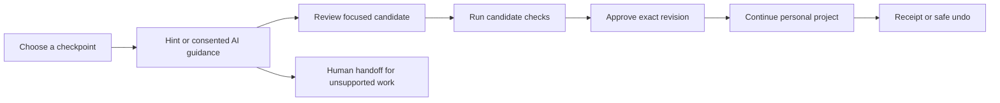
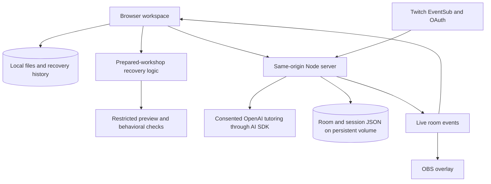

# Rejoin — Your Place in the Stream

**JavaScript · Node.js · OpenAI · AI SDK · Twitch EventSub · Acorn · Docker · Railway**

[Live product](https://rejoin-production-bec2.up.railway.app/?join=1) · [Instructor](https://rejoin-production-bec2.up.railway.app/?host=1) · [Stream overlay](https://rejoin-production-bec2.up.railway.app/?overlay=1) · [Source](https://github.com/ankitlade12/rejoin)

> **Catch up with the workshop. Keep what makes your project yours.**

Live coding moves quickly. One missing event handler can leave a beginner behind while the stream carries on. Copying the instructor's entire project can restore progress, but erase the learner's title, styles and personal touches.

Rejoin pairs a private browser workspace with a Twitch-connected classroom. Learners choose a checkpoint, ask for guidance, review a focused repair, check its behavior and decide whether to apply it. Instructors coordinate the lesson through chat and a dedicated console.

**Built for:** the TwitchCon × Codex hackathon

**Proposed first users:** beginners and instructors in community coding workshops

**Demo scope:** one live room and a prepared three-checkpoint HTML/CSS/JavaScript RSVP workshop with fictional event data

## Quick Highlights

- **Keep your work** — recovery preserves supported customizations instead of replacing the project.
- **Review before applying** — exact before/after views, candidate checks and explicit approval keep the learner in control.
- **Optional AI guidance** — review the script and question before consenting; authored hints work without an API key.
- **Twitch-driven teaching** — advance checkpoints, pause the lesson and offer an optional workshop-link reply from chat.
- **Private by default** — files stay in the browser; progress sharing and Twitch linking are separate choices.
- **Safe recovery history** — receipts retain attempts, approved changes and unfinished work; undo preserves later edits through a separate earlier-copy export.
- **Human handoff** — select files, inspect the exact redacted packet and download it for sharing.
- **Continue after the stream** — keep practicing locally when the instructor ends the workshop.

## Live Deployment

| Surface | Location | Access |
|---|---|---|
| Learner workspace | [Join the workshop](https://rejoin-production-bec2.up.railway.app/?join=1) | Public; no account required for private work |
| Instructor console | [Instructor view](https://rejoin-production-bec2.up.railway.app/?host=1) | Instructor password required |
| OBS browser source | [Stream overlay](https://rejoin-production-bec2.up.railway.app/?overlay=1) | Public lesson state and eligible aggregate signals |
| Health | [/api/health](https://rejoin-production-bec2.up.railway.app/api/health) | Public runtime status |
| Source | [GitHub repository](https://github.com/ankitlade12/rejoin) | Public |

The deployment serves one shared workshop room. Each browser profile has its own local project, while instructor checkpoint changes reach all connected learners. Use separate browser profiles for instructor and learner demonstrations.

## The Problem

A learner who falls behind needs more than a finished answer. They need to understand what changed, retain their own work and find a manageable next step. Meanwhile, a streamer cannot inspect every viewer's files or know who needs help without interrupting the lesson.

Rejoin explores this gap between watching a coding stream and continuing a personal project. Its community benefit is a product hypothesis; learning gains and reduced instructor workload have not been established through a human study.

## The Solution

| Question | Rejoin's response |
|---|---|
| Where is the workshop now? | Live instructor checkpoints and teaching notes |
| Where should I resume? | A learner-selected recovery target |
| What should I try next? | Authored hints or explicitly consented AI tutoring |
| What will change? | A focused candidate with exact file review and behavioral checks |
| Can I keep my version? | Protected files, revision guards and safe undo |
| How can I ask for help? | Optional progress signals or a reviewed help-packet download |

AI provides guidance. Deterministic workshop logic proposes edits. The learner approves the change; neither AI advice nor self-reported readiness establishes that the project passes its checks.

## Architecture Overview

### Recovery Lifecycle



### System Architecture



### Tech Stack

| Layer | Technology | Purpose |
|---|---|---|
| Interface | HTML, CSS, vanilla JavaScript | Editor, recovery review, instructor console and overlay |
| Server | Node.js | Sessions, authorization, tutoring and live SSE updates |
| Recovery | Acorn and prepared workshop contracts | Recognize supported script forms and propose focused changes |
| Preview | Sandboxed iframe and trusted harness | Check the supported rendered workshop behavior |
| AI | OpenAI Responses through AI SDK | Structured, optional tutoring with bounded input and output |
| Live integration | Twitch EventSub WebSocket and OAuth | Broadcaster commands and consented learner signals |
| Persistence | Browser localStorage and server JSON | Private projects locally; room/session state on the server |
| Verification | Node test runner and Python Playwright | Unit, API, browser and restart checks |
| Delivery | Docker and Railway | One continuously running service with persistent storage |

## Product Features

### A Workspace That Remains Yours

Edit `index.html`, `style.css` and `script.js`, personalize the event, and choose a recovery target independently of the instructor. Each file is limited to 100 KB of UTF-8 text. Save failures remain visible, and an instructor moving ahead does not overwrite local work. Export and import project copies for continuation.

### Guided Recovery With Explicit Approval

Choose an authored hint or optional AI guidance. AI receives only the approved script, question and checkpoint. Supported recovery candidates preserve comments and personal HTML/CSS, show the exact change and require passing candidate checks plus learner approval. Edits invalidate stale success messages; protected files and revision guards prevent unwanted application.

### Teaching Through Twitch

The instructor console controls checkpoints, pause/resume, checkpoint-linked teaching notes and workshop completion. Learners can dismiss notes. Chat provides the same checkpoint coordination without leaving the stream.

| Command | Who can use it | Behavior |
|---|---|---|
| `!checkpoint C1` | Broadcaster | Move to the first checkpoint and resume |
| `!checkpoint C2` | Broadcaster | Move to RSVP event binding and resume |
| `!checkpoint C3` | Broadcaster | Move to the final checkpoint and resume |
| `!pause` | Broadcaster | Pause workshop recovery |
| `!rejoin` | Chat participants | Return the public invitation link when the host enables replies |
| `!stuck` | Linked learner with sharing enabled | Report needing help |
| `!ready` | Linked learner with sharing enabled | Report readiness |

Optional replies require write permission and are limited to one per 30 seconds. Learner signals use validated Twitch identity, not a typed username. Commands are a workshop interface, not a general-purpose chatbot.

### Sharing and Human Help

Learners can separately opt into status, checkpoint and blocker reporting. Public breakdowns require at least five opted-in guests; individual blocker groups also need five reports. Code and private questions are excluded from the room and overlay.

Help packets contain only selected files, with best-effort credential redaction and an exact preview before download. Nothing is automatically forwarded. Once a packet is shared outside Rejoin, those copies cannot be revoked.

### History and Personal Continuation

Recovery receipts retain attempts, approved changes, checkpoint versions and unfinished work. Undo after later edits offers a separate pre-fix copy rather than replacing newer work. Ending the live room stops AI work and disconnects Twitch; learners can continue local practice, checks and exports.

## Judge Quick Start

Open [the learner workspace](https://rejoin-production-bec2.up.railway.app/?join=1).

1. Start privately and choose **C2** as the recovery target.
2. Personalize the event title in `index.html`.
3. Choose **Help me continue**, then an authored hint or consented AI guidance.
4. Review the suggested fix, check it and approve it.
5. Click the RSVP button and confirm that your title remains intact.
6. Add another edit, then explore undo and its separate earlier-copy export.
7. Inspect the help-packet preview, recovery receipt and optional community settings.

Instructor controls require the deployment owner's password. No instructor credential is published. The prepared example demonstrates a bounded recovery workflow, not arbitrary-program repair.

## Local Installation

Requirements: Node.js 22+; Node 24 is used by the container.

```sh
git clone https://github.com/ankitlade12/rejoin.git
cd rejoin
npm ci
npm run setup
npm run dev
```

Open http://localhost:4173. Setup creates an ignored `.env` with restricted permissions and a random instructor password; it never overwrites existing settings. Read that file locally to sign into the instructor view. `npm run doctor` reports configuration presence without displaying credentials.

Authored hints and local recovery work without provider credentials. The frontend is served directly from `dist/`; there is no separate frontend build step.

## Configuration

See [.env.example](.env.example). Keep credentials in local environment files or host secrets.

| Variable | Purpose |
|---|---|
| `REJOIN_HOST_PASSWORD` | Instructor password; minimum 16 characters |
| `PUBLIC_ORIGIN` | Exact browser origin; defaults to `http://localhost:4173`, without trailing slash |
| `HOST` / `PORT` | Bind address and port; defaults to loopback / 4173 |
| `OPENAI_API_KEY` | Enables optional runtime AI tutoring |
| `OPENAI_MODEL` | Model name; defaults to `gpt-5-mini` |
| `REJOIN_AI_CALL_LIMIT` | Room calls per hour; defaults to 40, with five per guest per hour |
| `TWITCH_CLIENT_ID` | Registered Twitch application client ID |
| `TWITCH_ACCESS_TOKEN` | Broadcaster-owned user token with `user:read:chat` |
| `TWITCH_CLIENT_SECRET` | Enables learner linking and renewable broadcaster authorization |
| `REJOIN_DATA_FILE` | Persistent JSON store; defaults to `.data/state.json` |

AI uses one request without automatic retries, a 24 KB script limit, a 1,000-character question limit, a 1,800-token output cap and a 45-second deadline. AI never applies code or certifies behavior.

## Twitch Integration

1. Register a Twitch application and add the exact callback: `http://localhost:4173/auth/twitch/callback` locally, or your public HTTPS origin followed by `/auth/twitch/callback` when hosted.
2. Configure the application client ID and secret. A manually supplied broadcaster user token needs `user:read:chat`; optional replies additionally need `user:write:chat`.
3. Sign into the instructor console and use **Authorize broadcaster chat** to obtain renewable authorization.
4. Send a checkpoint command as the broadcaster and observe the connected learner page or overlay.
5. In a separate learner browser profile, link Twitch, explicitly enable sharing and save before using `!stuck` or `!ready`.
6. Enable public `!rejoin` replies in the instructor console only when wanted.

Learner linking requests no resource scopes; the temporary identity token is validated and discarded. Linking expires with the 24-hour guest session. Broadcaster refresh tokens are encrypted on the persistent volume using a key derived from the instructor password. Changing that password requires reconnecting Twitch. A manually supplied token without a refresh grant still needs replacement when it expires. Connection gaps remain visible; missed events are not reconstructed.

## Reproducible Verification

```sh
npm run check
npm test
node test/load.mjs
```

The workshop manifest pins version 1.1.0, reference hashes, prerequisites, check identifiers and the trusted preview harness hash. `npm run validate:workshop` rejects changed contracts.

For browser verification, install Python Playwright and Chromium, then start a disposable room without live provider credentials:

```sh
python3 -m venv .venv
.venv/bin/pip install playwright
.venv/bin/playwright install chromium
REJOIN_HOST_PASSWORD=test-only-password-123456 \
  REJOIN_DATA_FILE=/tmp/rejoin-browser-check/state.json \
  node server.mjs
```

In another terminal:

```sh
.venv/bin/python test/release.py
```

Use a fresh disposable data directory and keep port 4173 free. The suite changes its room; do not point it at the public workshop. `REJOIN_TEST_URL` selects another test origin and `CHROMIUM_PATH` selects an installed browser.

Recorded verification on November 1, 2026, for application revision `fc8cf30`:

| Check | Recorded result |
|---|---|
| Node tests | 25 passed |
| Syntax and workshop manifest | Passed |
| Browser release suite | 30 identified fixture outcomes and all three reference checkpoints passed |
| Recovery regressions | Stale success, save failure, keyboard import and exact redacted handoff passed |
| Local restart and concurrency | Ten clients; room, sessions and opt-in reports persisted across restart |
| Hosted integration | Real OpenAI recovery, Twitch checkpoint delivery and hosted restart observed |

The benchmark covers five fixture categories, including explicit abstentions for unsupported code. It is not complete PRD coverage or evidence of general model accuracy. Automated three-persona checks do not replace three human participants; automated accessibility checks do not establish screen-reader usability or WCAG conformance.

## Repository Structure

```text
rejoin/
├── dist/                       # Interface, recovery logic, preview and manifest
├── lib/                        # AI, Twitch, OAuth, room storage and validation
├── scripts/                    # Setup, diagnostics, manifest and video tooling
├── test/                       # Node tests, browser journeys and fixtures
├── server.mjs                  # HTTP routes, sessions and live room events
├── Dockerfile
├── railway.json
├── package.json
├── .env.example
└── README.md                   # Product, setup and release information
```

## Deployment

```sh
docker build -t rejoin .
docker volume create rejoin-data
docker run --rm -p 4173:4173 --env-file .env -e HOST=0.0.0.0 \
  -v rejoin-data:/app/.data rejoin
```

Use one continuously running instance behind HTTPS with a writable persistent volume. Set `PUBLIC_ORIGIN` to the exact external origin, register its Twitch callback and proxy SSE without buffering. The [Dockerfile](Dockerfile) and [Railway configuration](railway.json) serve UI and API together. Verify health, authorization, checkpoint delivery and persistence after deployment.

The JSON store is intended for one process. Multiple replicas, ephemeral serverless storage and static-only hosting do not support the complete application. There are no automatic backups.

## Privacy and Execution Boundaries

- Files and local recovery history remain in browser storage unless explicitly shared for AI or exported. One browser profile shares that storage.
- AI receives only approved script/question/checkpoint data. Rejoin does not retain uploaded code or model transcripts; provider requests use `store:false`, and provider retention policies still apply.
- Server storage contains room state, hashed session tokens, CSRF values, optional linked Twitch identities and consented progress. Guest sessions expire after 24 hours.
- Workspace deletion aborts active AI work, removes the server session/link/sharing and clears local files after server deletion succeeds.
- The iframe uses an opaque origin, an HTML allowlist and a network-denying CSP. Arbitrary learner JavaScript never executes: recognized workshop forms run as trusted canonical equivalents.
- Candidate checks cover that constrained representation. Unsupported programs receive a handoff; visual quality and general code correctness are not certified.
- Secret screening is best-effort. Review every packet before forwarding it.
- Fonts load from Google Fonts with offline fallbacks. No analytics are included.

## Production Boundary and Next Steps

Rejoin is a single-room hackathon MVP with one prepared workshop. Multi-room hosting, arbitrary code execution, cloud project sync and a general workshop-authoring interface are outside the current implementation.

Live learner `!ready`, broadcaster checkpoint delivery and a visible `!rejoin` reply were observed. A distinct consented `!stuck` status transition and actual broadcaster token renewal still need end-to-end confirmation. Renewable OAuth support in the code is not evidence that a refresh grant was saved or renewed in the hosted room.

Before broader adoption, complete human screen-reader review and a three-person workshop rehearsal, validate community demand, and add operational backups and appropriate multi-room persistence. No learning improvement, time savings or human accessibility certification is claimed.

*Keep learning. Keep your work. Rejoin the stream.*
