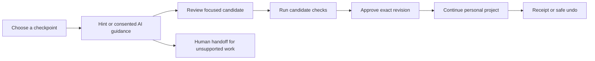

# Rejoin — Your Place in the Stream

**Live coding workshops · Guided recovery · Twitch community**

[Live product](https://rejoin-production-bec2.up.railway.app/?join=1) · [Instructor](https://rejoin-production-bec2.up.railway.app/?host=1) · [Stream overlay](https://rejoin-production-bec2.up.railway.app/?overlay=1) · [Source](https://github.com/ankitlade12/rejoin)

> **Catch up with the workshop. Keep what makes your project yours.**

Live coding moves quickly. One missing event handler can leave a beginner behind while the stream carries on. Copying the instructor's entire project can restore progress, but erase the learner's title, styles and personal touches.

Rejoin pairs a private browser workspace with a Twitch-connected classroom. Learners choose a checkpoint, ask for guidance, review a focused repair, check its behavior and decide whether to apply it. Instructors coordinate the lesson through chat and a dedicated console.

**Built for:** the TwitchCon × Codex hackathon

**Built for learners and instructors:** beginners and instructors in community coding workshops

**Current workshop:** one live room and a prepared three-checkpoint HTML/CSS/JavaScript RSVP workshop with fictional event data

## Quick Highlights

- **Keep your work** — recovery preserves supported customizations instead of replacing the project.
- **Review before applying** — exact before/after views, candidate checks and explicit approval keep the learner in control.
- **Optional AI guidance** — review the script and question before consenting; authored hints work without an API key.
- **Twitch-driven teaching** — advance checkpoints, pause the lesson and offer an optional workshop-link reply from chat.
- **Private by default** — files stay in the browser; progress sharing and Twitch linking are separate choices.
- **Safe recovery history** — receipts retain attempts, approved changes and unfinished work; undo preserves later edits through a separate earlier-copy export.
- **Human handoff** — select files, inspect the exact redacted packet and download it for sharing.
- **Continue after the stream** — keep practicing locally when the instructor ends the workshop.

## The Problem

A learner who falls behind needs more than a finished answer. They need to understand what changed, retain their own work and find a manageable next step. Meanwhile, a streamer cannot inspect every viewer's files or know who needs help without interrupting the lesson.

Rejoin explores this gap between watching a coding stream and continuing a personal project. Its community benefit is a product hypothesis; learning gains and reduced instructor workload have not been established through a human study.

## The Solution

| Question | Rejoin's response |
|---|---|
| Where is the workshop now? | Live instructor checkpoints and teaching notes |
| Where should I resume? | A learner-selected recovery target |
| What should I try next? | Authored hints or explicitly consented AI tutoring |
| What will change? | A focused candidate with exact file review and behavioral checks |
| Can I keep my version? | Protected files, revision guards and safe undo |
| How can I ask for help? | Optional progress signals or a reviewed help-packet download |

AI provides guidance. Deterministic workshop logic proposes edits. The learner approves the change; neither AI advice nor self-reported readiness establishes that the project passes its checks.

## How Rejoin Works

### Recovery Lifecycle



## Product Features

### A Workspace That Remains Yours

Edit `index.html`, `style.css` and `script.js`, personalize the event, and choose a recovery target independently of the instructor. Each file is limited to 100 KB of UTF-8 text. Save failures remain visible, and an instructor moving ahead does not overwrite local work. Export and import project copies for continuation.

### Guided Recovery With Explicit Approval

Choose an authored hint or optional AI guidance. AI receives only the approved script, question and checkpoint. Supported recovery candidates preserve comments and personal HTML/CSS, show the exact change and require passing candidate checks plus learner approval. Edits invalidate stale success messages; protected files and revision guards prevent unwanted application.

### Teaching Through Twitch

The instructor console controls checkpoints, pause/resume, checkpoint-linked teaching notes and workshop completion. Learners can dismiss notes. Chat provides the same checkpoint coordination without leaving the stream.

| Command | Who can use it | Behavior |
|---|---|---|
| `!checkpoint C1` | Broadcaster | Move to the first checkpoint and resume |
| `!checkpoint C2` | Broadcaster | Move to RSVP event binding and resume |
| `!checkpoint C3` | Broadcaster | Move to the final checkpoint and resume |
| `!pause` | Broadcaster | Pause workshop recovery |
| `!rejoin` | Chat participants | Return the public invitation link when the host enables replies |
| `!stuck` | Linked learner with sharing enabled | Report needing help |
| `!ready` | Linked learner with sharing enabled | Report readiness |

Optional replies require write permission and are limited to one per 30 seconds. Learner signals use validated Twitch identity, not a typed username. Commands are a workshop interface, not a general-purpose chatbot.

### Sharing and Human Help

Learners can separately opt into status, checkpoint and blocker reporting. Public breakdowns require at least five opted-in guests; individual blocker groups also need five reports. Code and private questions are excluded from the room and overlay.

Help packets contain only selected files, with best-effort credential redaction and an exact preview before download. Nothing is automatically forwarded. Once a packet is shared outside Rejoin, those copies cannot be revoked.

### History and Personal Continuation

Recovery receipts retain attempts, approved changes, checkpoint versions and unfinished work. Undo after later edits offers a separate pre-fix copy rather than replacing newer work. Ending the live room stops AI work and disconnects Twitch; learners can continue local practice, checks and exports.

## Get Started

Open [the learner workspace](https://rejoin-production-bec2.up.railway.app/?join=1).

1. Start privately and choose **C2** as the recovery target.
2. Personalize the event title in `index.html`.
3. Choose **Help me continue**, then an authored hint or consented AI guidance.
4. Review the suggested fix, check it and approve it.
5. Click the RSVP button and confirm that your title remains intact.
6. Add another edit, then explore undo and its separate earlier-copy export.
7. Inspect the help-packet preview, recovery receipt and optional community settings.

Instructor controls require the workshop owner's password. Learners can explore recovery without signing into the instructor console.

## Local Installation

Requirements: Node.js 22+; Node 24 is used by the container.

```sh
git clone https://github.com/ankitlade12/rejoin.git
cd rejoin
npm ci
npm run setup
npm run dev
```

Open http://localhost:4173. Setup creates an ignored `.env` with restricted permissions and a random instructor password; it never overwrites existing settings. Read that file locally to sign into the instructor view. `npm run doctor` reports configuration presence without displaying credentials.

Authored hints and local recovery work without provider credentials. The frontend is served directly from `dist/`; there is no separate frontend build step.

## Connect Your Community

Instructors authorize their Twitch channel from the instructor console, then use chat commands to coordinate the workshop. Public workshop-link replies are optional and can be enabled from the console.

Learners can work privately without linking Twitch. To report progress through chat, link your account, enable sharing and save your choice before sending `!stuck` or `!ready`. Use separate browser profiles when demonstrating instructor and learner roles.

## Privacy and Control

- Your project stays in your browser unless you explicitly share code for AI guidance or export it.
- AI guidance and community progress sharing require separate permission.
- Review the exact code before requesting AI help, and approve each repair yourself.
- Choose which files go into a help packet and review its redacted contents before sharing. Redaction can miss sensitive text.
- Community progress excludes your code and private questions. Small public groups remain hidden.
- Unlink Twitch or delete your workspace from the application settings.

## Supported Workshop

Rejoin currently supports one shared room and a prepared three-checkpoint RSVP workshop using HTML, CSS and JavaScript. Recovery recognizes supported workshop patterns; unfamiliar code is handed off for human help. Projects are stored on your device, with export and import for moving your work.

*Keep learning. Keep your work. Rejoin the stream.*
